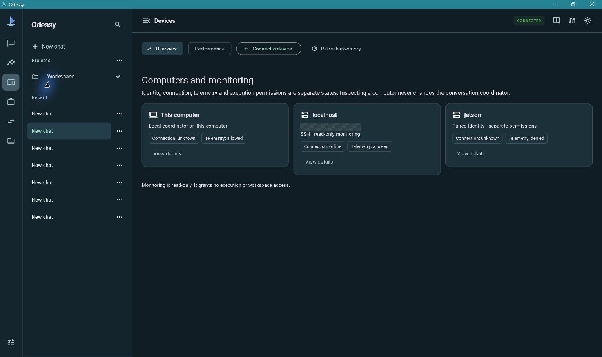

# Odessy desktop manual

**English** | [简体中文](zh-CN/GOLDEN_PATH.md) | [Español](es/GOLDEN_PATH.md)

**Developer Preview · v0.5.0-alpha · Windows 11**

**First success:** connect a real model, deny one local command, then approve a new request and verify its tool output. Complete sections 1–3 on one Windows laptop. Voice, wake words and SSH are optional exercises after that finish line; they are not prerequisites.

The model proposes actions; the service applies policy and obtains required approval before execution. Use a disposable workspace. Windows confinement is partial, and cloud requests and permitted tool observations leave your computer for the chosen provider.

**Reviewed 18 November 2026.** The desktop-managed launch is backed by source/launcher tests; policy checks use `develop` revision `1a50944ca717f9b5590063bdf1a7566054cf90be`. The maintainer's installed screenshots and earlier checks use source `7f3b925`; they do not certify a fresh installation of the later revision or every step below. A new external-user run remains to be recorded.

If this path does not work for you, [open an issue](https://github.com/Trisoma/odessy/issues/new/choose) with the **sanitized doctor output** and the failing step. See [Troubleshooting and reporting](#troubleshooting-and-reporting).

## 1. Install and open Odessy

### Prerequisites

- Windows 11 x64, an internet connection, and a disposable local folder for commands.
- For this walkthrough, a DeepSeek API account with an active API key, access to the chosen model and sufficient API credit. Provider usage can incur charges. A GPU, microphone and second computer are not required.
- **Source setup only:** [Git](https://git-scm.com/downloads/win), Python 3.13 with the Windows `py` launcher, [Node.js 22](https://nodejs.org/en/download), and [Flutter 3.47.7 stable](https://docs.flutter.dev/install). Flutter Windows builds require Visual Studio's **Desktop development with C++** workload and a Windows SDK; check `flutter doctor -v`. Native Node modules may also need those build tools. The full source setup is larger than an end-user install.

Choose **one** route below. A packaged candidate includes its supported runtime; its users do not need the development SDKs.

### A. Supplied installer

As of this review, the [public releases](https://github.com/Trisoma/odessy/releases) contain the older `v0.5.0-unstable` UI-client archives, **not a matching current full installer**. Do not use those archives for this walkthrough. If you have not received a full candidate with a checksum and source revision from its distributor, use route B.

For a supplied Windows x64 setup EXE, compare its hash with that candidate's checksum manifest before opening it:

```powershell
Get-FileHash -Algorithm SHA256 -LiteralPath 'C:\path\to\OdessySetup.exe'
```

The filename above is a placeholder for your download. The maintainer's installation was upgraded to source `7f3b925` through the versioned installation owners; that receipt is not a fresh public-installer qualification. See the [installed verification record](verification/ssh-voice-installed-update-2026-11-18.md).

1. Open the supplied installer and choose **Coordinator host + local execution**.
2. Choose an installation folder, review the components, install, and select **Open Odessy**. The [setup wizard guide](setup/wizard.md) explains the available choices.
3. Configure a model as described below. Once connected, use **Workspaces** to choose a folder you can safely use for experiments.
4. Find projects and saved chats on the left, the message composer below chat, and the inspector toggle at the top right.


*Desktop gallery example. The project sidebar lets you switch between saved conversations.*

### B. Build the production desktop from source

Follow [Getting started](getting-started.md) for the exact Windows dependencies and
**desktop-managed source launch**. It starts the configured service from the app;
you do not manually start Python, copy a bearer token, or enter a provider key in a terminal.
Then return to section 2. Manual server and fake-model commands belong to advanced
contributor checks and are not required for this walkthrough.

## 2. Configure DeepSeek

Choose **Custom** as the runtime for new chats. Custom selects the agent runtime and DeepSeek supplies the model. Source configuration calls this engine `legacy`; it is the same Custom engine.

The installed app and the managed source desktop both configure the model through
Settings and own their service's lifecycle. Save and follow any indicated apply or
restart step. If the service is not connected, use **Connect saved configuration**;
do not substitute the manual **Connect local service** token dialog.

1. In **Settings → Models and connections**, choose **DeepSeek**. Use the provider default endpoint (`https://api.deepseek.com/v1`) and select or enter `deepseek-flash`, the model ID recorded in the maintainer's installation.
2. Enter your DeepSeek API key in the masked field. Choose **Save securely** or **Use for this session only**, then save the model configuration. See [model credentials](setup/secure-model-credentials.md).
3. Start a new Custom chat and type “Reply with one sentence confirming you can see this message.” Check the active model and look for a reply. If it fails, check the provider, model ID, credential status and connection error.

DeepSeek API is the maintainer-tested example in this guide. Odessy also supports other API providers and local models. With limited testing resources, we have not human-verified those configurations for this walkthrough.


*Desktop gallery example. Select the model and provider in Models and connections.*

## 3. Run a command on your Windows laptop

This is the core approval exercise. It needs only your Windows laptop. The Windows command `hostname` prints your computer's name, such as `MY-LAPTOP`, then exits without changing files or settings. We use it because its real tool output is easy to compare with PowerShell. `terminal.run` is Odessy's tool for running that command; it is not another command you need to install. Keep execution local; disconnect any selected SSH/LAN execution target first. Select a disposable folder through **Workspaces**, save, and follow any restart prompt before creating the chat. This applies to both the installed and managed source app.

1. Start a **new Custom chat** with your real model. In the composer's shield menu (**Service permissions**), select **Ask every time**. Wait for the service acknowledgment; if the control reports unavailable or an error, stop. Ordinary allowed reads can still run without prompting; this exercise uses `hostname`, which the default policy classifies as requiring confirmation.
2. Send this exact prompt:

   ```text
   Use terminal.run to run exactly hostname on this Windows laptop in the current workspace. Do not use SSH, substitute another command, or retry if I deny it. Show the tool's stdout and exit code.
   ```

3. Inspect the approval's tool, exact arguments and target. It must be local `terminal.run` with command `hostname` in your chosen workspace. Select **Deny**. Expect a denied result and no successful execution result for that request. If the model proposes an alternative, deny it and stop the turn rather than approving a different action.
4. Send the same prompt as a **new request**. Review its new approval, then choose **Approve once**. If the arguments or target differ, deny and investigate. This approval does not grant blanket access to later commands.
5. Open the inspector's **Output** panel while this live session is active. Expect the `terminal.run` result to contain a nonempty hostname and exit code `0`. Run `hostname` yourself in PowerShell and compare the names. An assistant sentence saying it succeeded is not sufficient.

**Finish line:** a real model replied, a local request was denied, a separately approved request returned matching tool output, and the local target was clear. You can stop here and report your result; the remaining exercises are optional.

With the default policy, the non-executing check below reports `decision: confirm` and `asks: true`. Run it from your disposable workspace using the source environment's Python if the UI unexpectedly skips the approval:

```powershell
$previewPython = 'C:\path\to\odessy-preview\.venv\Scripts\python.exe'
& $previewPython -m odessy permissions check 'hostname' --json
```

Replace `C:\path\to\odessy-preview` with your actual source checkout. This optional diagnostic requires that checkout's Python environment; installed-only users can report the visible approval and Output instead.

This check never runs `hostname` and does not override live mode, custom rules, hooks or saved preapprovals. **Ask every time** does not mean every harmless read prompts. If your configuration differs, report it; do not weaken policy to force this exercise to pass.

[](view/main/basic-chat.png)

*Installed Windows preview: Output shows underlying `terminal.run` results. This recorded exchange lists workspace/Desktop files; it is not a capture of the `hostname` exercise above. One Desktop-path lookup failed with exit `1`; a later command resolved the redirected Desktop path and completed with exit `0`. Check each tool result rather than relying only on the assistant's reply.*

## 4. Optional: configure voice and the wake word

Configure compatible speech components in the installed or managed source app before this exercise. Source build dependencies do not include the speech models or all audio dependencies; follow [Voice components](setup/voice-components.md). The managed source launch uses the configured voice lifecycle, while a separately launched manual API server may omit it.

1. In **Settings**, open **Speech to text**, **Text to speech**, and **Voice** to choose your supported speech components, microphone and output device. Save the changes. If prompted to supply or download assets, follow [Voice components](setup/voice-components.md). Wake models are a separate opt-in.
2. Open the composer's **Voice options → Test speech output**. Then choose **Test speech input · no model call** and say a short sentence. Check the playback and transcript separately.
3. Try push-to-talk. Then enable wake listening. With the bundled Jarvis model, say **“Hey Jarvis”**, wait for the listening cue, and ask a short question.
4. Stop wake listening from the voice controls before changing audio devices. If a settings change is deferred, finish the current audio operation and check that the change applies when audio is idle.


*Desktop gallery examples. Speech recognition configures transcription. Voice settings control the listening behavior.*

If there is no transcript, start with the microphone and input test. If text arrives slowly after a transcript appears, check the model response. If text appears before speech, check synthesis and the selected speaker. Voice can feel slow on the tested setup. Include the stage where you observed the delay when reporting it.

## 5. Optional: run a command on another computer over SSH

As in the local exercise, `hostname` prints the selected computer's name. Here the command runs on the SSH computer rather than your Windows laptop. The worked setup example is a **Jetson Orin Nano Super**. Use your own reachable SSH computer with a POSIX shell and an account you can already log into. Connection addresses are omitted from this guide and redacted in the screenshots.

1. In **Devices → Connect a computer**, enter an SSH alias or `user@hostname`. Fill in the port if required. Leave the password blank to use your configured SSH key or agent. Verify the host key independently and follow the [SSH trust instructions](setup/ssh-computers.md) if it is unknown or changed.

   

   *Real installed Odessy window after login to the maintainer's Debian computer. The address, port and address helper example are mosaicked for privacy. The password field is empty. Use your own connection details.*

2. Select **Connect**. Login starts read-only monitoring. Open **Devices → Overview** to find the connected computer and its discovered hostname. Check monitoring freshness separately from login status.

   

   *Real Devices overview. The connected Debian computer reports the hostname `localhost` and appears online with read-only SSH monitoring. The separate `jetson` card is a saved entry, not the computer connected in this capture. Connection identity is mosaicked.*

3. Return to **Connect a computer**. Login alone does not enable agent commands: the status below shows **Agent commands · not selected**. Scroll to **Use for agent commands** and select it separately. This opens a new Custom chat with the SSH tool available.

   

   *Real installed Odessy window, scrolled to show **Use for agent commands**. Login and transport are verified; the session is online and ready, while agent commands remain **not selected**. This capture precedes command access. Private connection details are mosaicked.*

4. In the new chat, type **“On the selected SSH computer, run `hostname` using `ssh.run`.”** Check the exact command and target in the approval and decline it once. Confirm there is no successful remote result for that request. Ask again, review the approval, and approve once. Check the returned tool output and exit code in the active chat's **Output** panel.
5. Compare the two exercises: local `hostname` should return your Windows laptop's name; remote `hostname` should return the selected SSH computer's name. Select **Disconnect agent commands** when finished.

The maintainer's saved SSH exchange came from a **separate Debian x86-64 computer**, not the Jetson setup example. Its recorded `ssh.run` result was:

```text
stdout: localhost
exit code: 0
```

This is a text excerpt of the confirmed tool result, not a command-result screenshot. `localhost` was that Debian computer's configured hostname; it does not mean the SSH command ran on the Windows coordinator. On your own host, compare with `hostname` in an independent SSH session.

When the saved SSH chat was reopened, the assistant reply was visible but the resumed session's **Output** panel was empty. No live SSH tool-output screenshot was saved. The real connection and Devices captures above establish login and connection state; they do not show command execution. For the exercises, inspect Output while the command's live session is active.

The full-window SSH captures were taken from the installed app on **18 November 2026**. Their installed executable identity, privacy edits and evidence limits are recorded in the [capture manifest](view/manual-ssh-live/manifest.json).

The current SSH flow has several manual steps. Monitoring and command selection have separate controls, enabling commands starts a new chat, and restarting the service requires reconnecting. Commands run with the SSH account's permissions and without a remote sandbox. Use the target shown in the approval to distinguish a remote command from a laptop command. The [SSH guide](setup/ssh-computers.md) covers connection loss and supported targets.

## 6. Optional: explore the desktop

| Where | What to try |
| --- | --- |
| **Projects and history** | Create or switch projects, open a saved chat, search history, or use the chat menu to rename, pin, archive or export. Custom supports bounded continuation after restart. Harness restart history is read-only. |
| **Composer** | Change the model for the next turn. Open service permissions and check the effective mode. SSH commands still require explicit approval. |
| **Inspector** | Browse workspace **Files**, recorded **Output**, and **Changes**. An available interactive **Terminal** uses a separate shell grant and runs under your OS account. [Terminal and checkpoints](ui/terminal-checkpoints.md) |
| **Context, memory and documents** | Inspect context used by a turn, review project memory, or opt in to document indexing and follow retrieval citations. Availability depends on runtime and configuration. |
| **Checkpoints** | Review or preview recorded workspace checkpoints. Windows supports checkpoint creation, listing and preview. Restoration is disabled. |
| **Activity & usage** | Check recorded activity and model usage for this installation. |
| **Devices, Jobs and Handoffs** | Check available hosts, then inspect recorded jobs or handoffs when the corresponding feature has activity. |
| **Settings** | Explore general appearance, models and connections, speech to text, text to speech, voice, devices and tool access, advanced settings and installation maintenance. |

[Browse the illustrated desktop gallery](view/README.md) · [Current limitations](../LIMITATION.md)

## Troubleshooting and reporting

These are known constraints and likely failure points on this walkthrough. The [full limitations](../LIMITATION.md) also cover capabilities outside the core path.

| Symptom or boundary | What to do |
| --- | --- |
| No matching installer download | Use source route B. The old UI-client archive is not a complete replacement for the current app/service. |
| Python, npm or Flutter setup fails | Check the prerequisites, Python 3.13 launcher, Node 22 and `flutter doctor -v`. Windows C++ tools are required for native builds. Do not continue after a failed dependency/build command. |
| Startup fails, connection refused or HTTP 401 | In the managed app, inspect the startup error and saved configuration, then retry **Connect saved configuration**. It owns its port/token. Source builds need all managed-launch defines. Only a deliberately manual API connection uses operator-entered ports/tokens. |
| Model reports authentication, model-not-found, rate-limit or credit errors | Check provider endpoint, current model ID and account access/credit. Doctor finding a key does not validate it online. Report the provider error without the key. Do not assume a failed request was free. |
| Secure key save fails | Use **Use for this session only** deliberately or repair the supported OS credential backend. Both managed launch routes pass session credentials privately; saving a key in plaintext is not a workaround. |
| No approval, or a different command/target appears | Check Custom, effective **Ask every time**, local target, selected workspace and any saved command preapprovals/hooks. Deny mismatched requests; inspect the non-executing policy check above. Neither a panel nor a mode selection grants new workspace rights. |
| Denied command is proposed again | Denial does not execute that proposal. Stop the turn and report the repeated proposal; do not approve it merely to make the UI progress. |
| Command fails or exit code is nonzero | Read the actual Output and approval arguments. Check workspace validity and shell/tool readiness. Do not disable confinement or use Full control as a setup workaround. Windows confinement remains partial even when the command succeeds. |
| Output is empty after reopening history | The maintainer observed an empty resumed SSH Output panel. Inspect and capture the live tool result before closing the chat; do not rerun an action just to recreate evidence. History and assistant prose are not proof of new execution. |
| Saved chat cannot continue | Use the matching profile/workspace. Custom continuation is bounded; Harness restart history is read-only. Do not delete the history database to repair selection. |
| Optional voice or Devices is unavailable | Typed local chat does not require either feature. Check the selected audio device and individual STT/TTS tests; SSH login, monitoring readiness and command authorization are separate. Reconnect temporary SSH sessions after service restart. |
| A cloud or shell action exposes data | Cloud requests and allowed tool observations are sent to the configured provider. Shell actions have the documented host permissions; approvals are not a complete OS sandbox. Use disposable, non-sensitive data. Windows checkpoint restoration is disabled and is not a rollback for executed commands. |

### Collect diagnostics

For **source route B**, keep the visible startup/model error and source revision.
From the repository root in a separate development terminal, use the same checkout's
Python and source-managed profile for a supplementary diagnostic:

```powershell
$previewRepo = (Get-Location).Path.Replace('\', '/')
$previewPython = "$previewRepo/.venv/Scripts/python.exe"
$env:ODESSY_CONFIG_FILE = "$previewRepo/build/local-desktop/state/odessy.env"
& $previewPython -m odessy doctor --model-backend deepseek 2>&1 |
    Tee-Object -FilePath "$previewRepo/build/local-desktop/doctor.txt"
```

Replace `deepseek` with your configured backend. Add `--voice` only when diagnosing
the optional wake/voice exercise. Doctor checks one process's configuration and
available tooling; a desktop session-only key is deliberately not inherited by this
separate terminal. It does not fully verify the selected desktop configuration,
provider inference, Piper compatibility or physical audio. Record that limitation
instead of putting credentials in a file to make doctor pass. It can probe configured
endpoints or list configured tools; it does not download models.

For an **installed candidate**, collect **Settings → Manage installation → Check installed files** results and its build/version identity. If you also run doctor, use that candidate's own interpreter and profile, not an unrelated system Python or checkout. If you cannot locate those, report the installation check and request the matching diagnostic command; do not guess a different runtime or reinstall first.

Read the report before sharing. Remove API keys, bearer tokens, credential-bearing URLs, private addresses/account names, sensitive paths and any private tool/file content. Redaction is best-effort; never attach your environment, profile files or history database as a substitute.

[Open an issue with sanitized diagnostics](https://github.com/Trisoma/odessy/issues/new/choose), including:

- Installation route, source/build revision and Windows version.
- The exact numbered step, expected result and observed error.
- Sanitized doctor output (or the installed-file check when doctor is unavailable).
- For the core exercise, whether Deny prevented execution and whether Approve once produced matching `hostname` output with exit `0`.

## Help improve the part you just tried

- **Verify another model.** Try a different API provider or a local model and report the exact configuration and first successful turn. Start with the [provider registry](../src/odessy/model_providers.py) and [desktop model round-trip test](../tests/test_desktop_cloud_roundtrip.py).
- **Measure a slow voice turn.** Record the device, model and where you noticed the delay. Start with [voice performance](ui/voice-performance.md) and the [hybrid audio tests](../tests/test_hybrid_audio.py).
- **Improve SSH onboarding.** Try connecting a device from a fresh profile and identify the step that made it hard to tell whether commands were enabled. Start with the [SSH connection controller](../apps/desktop/lib/app/ssh_connection_controller.dart) and [SSH execution UI tests](../apps/desktop/test/ssh_execution_test.dart).

For a focused first PR, choose an [open GitHub issue](https://github.com/Trisoma/odessy/issues) and comment with your proposed scope. The issues include files, acceptance criteria and checks. See [Contributing](../CONTRIBUTING.md#path-to-area-ownership) for review and continuing area responsibility.
