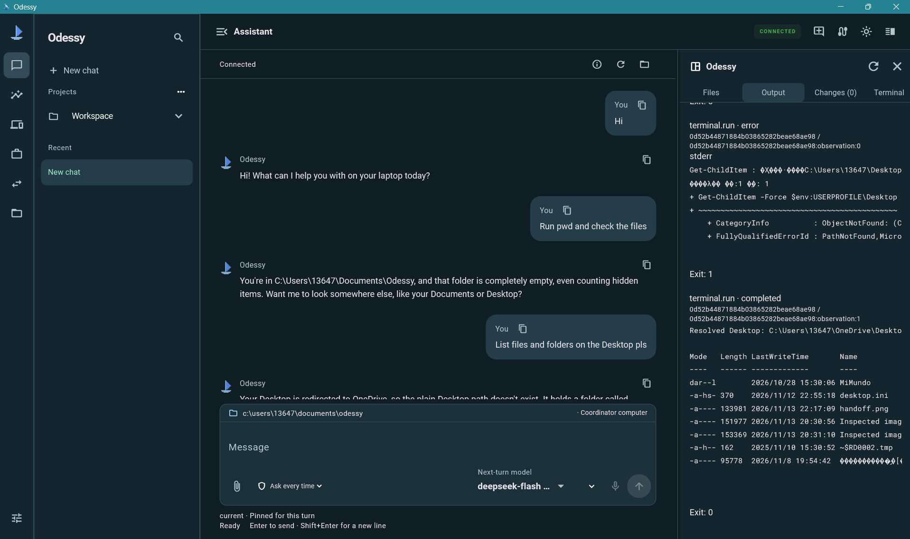

# Odessy 桌面版操作手册

[English](../GOLDEN_PATH.md) | **简体中文** | [Español](../es/GOLDEN_PATH.md)

> 说明：英文文档为权威版本（canonical），本页为简体中文翻译，仅供参照；界面截图显示英文界面，应用本身尚未本地化。

**Developer Preview · v0.5.0-alpha · Windows 11**

**首次成功：**连接一个真实模型，拒绝一条本地命令，然后批准一个新请求并核对它的工具输出。在一台 Windows 笔记本上完成第 1–3 节。语音、唤醒词和 SSH 是到达该终点之后的可选练习；它们不是前置条件。

模型提出操作建议；服务在执行前应用策略并取得所需批准。请使用一次性工作区。Windows 的隔离限制并不完整，云请求和经允许的工具观察内容会离开你的计算机，发送给所选提供商。

**更新日期：2026 年 11 月 18 日。**下述安装包基于 `1834c1a` 加已记录的未提交 Piper/安装修复；维护者已确认安装成功。参见[候选版本及检查范围](../verification/windows-piper-installer-2026-11-18.md)（English only）。现有截图对应较早构建（`7f3b925`），不能证明所有较新功能或外部用户的完整操作流程。

如果这条路径对你不适用，请带着**脱敏后的 doctor 输出**和失败的步骤[提交 issue](https://github.com/Trisoma/odessy/issues/new/choose)。参见[故障排查与报告](#故障排查与报告)。

## 1. 安装并打开 Odessy

### 前置条件

- Windows 11 x64、互联网连接，以及一个用于执行命令的一次性本地文件夹。
- 本演练需要一个 DeepSeek API 账号，且 API 密钥有效、可访问所选模型并有足够的 API 额度。提供商用量可能产生费用。无需 GPU、麦克风和第二台计算机。
- **仅源码安装：** [Git](https://git-scm.com/downloads/win)、带 Windows `py` 启动器的 Python 3.13、[Node.js 22](https://nodejs.org/en/download) 和 [Flutter 3.47.7 stable](https://docs.flutter.dev/install)。Flutter 的 Windows 构建需要 Visual Studio 的 **Desktop development with C++**（使用 C++ 的桌面开发）工作负载和 Windows SDK；请用 `flutter doctor -v` 检查。原生 Node 模块也可能需要这些构建工具。完整的源码安装比终端用户安装更庞大。

请在下面选择**一种**方式。打包候选版本包含其支持的运行时；其用户不需要开发 SDK。

### A. 提供的安装程序

Windows x64 候选安装程序 **`Odessy-v0.5.0-alpha-windows-x64-setup.exe`** 已重新构建，维护者于 2026 年 11 月 18 日确认安装成功。请使用维护者提供或[发布页面](https://github.com/Trisoma/odessy/releases)上带校验值的匹配候选版本。本文不会自动发布下载文件；旧的 `v0.5.0-unstable` UI 归档不能替代它。如果无法取得匹配安装包，请使用方式 B。

打开前核对下载文件的 SHA-256：

```powershell
Get-FileHash -Algorithm SHA256 -LiteralPath '.\Odessy-v0.5.0-alpha-windows-x64-setup.exe'
```

本候选版本的 SHA-256：`15063674bf944db7beae83fa4b55318aca831e47801db7d3828a41f6edf831ae`。后续构建必须附有自己的校验值及验证记录。参见[候选版本回执](../verification/windows-piper-installer-2026-11-18.md)（English only）。

1. 打开 EXE，选择安装目录。通常保留默认的协调端与本地执行；其他角色位于 **Custom setup**。最终用户无需 Python、Node 或 Flutter 开发 SDK。
2. 在 **Speech output engine** 中选择 **Piper (recommended for CPU)** 或 **Kokoro**。要自动安装语音，请开启 **Install voice components**。无需事先安装 Piper：确认安装后，向导会下载固定版本的引擎、英语语音、匹配的模型元数据、Whisper.cpp 及音频依赖。请审阅下载大小及许可证；可选下载需要联网。
3. 如需唤醒词，单独开启 **Install the wake-word model**；其模型许可证为 CC BY-NC-SA 4.0。语音与唤醒均可跳过，继续使用文字聊天。**Use existing voice components** 是手动使用已有文件的选项，不会补装缺失组件。
4. 审阅计划并点击 **Install**。缓存命中时可能显示剩余下载为零；向导仍会在本次安装中安装并验证软件包。等待安装完成，再点击 **Open Odessy**。详见[安装说明](../setup/wizard.md)及[语音组件](../setup/voice-components.md)（English only）。
5. 按下文配置模型，通过 **Workspaces** 选择一次性工作区。连接音频设备后，在 Settings 中测试 STT/TTS，并主动启用唤醒监听；文件安装成功并不等于麦克风或扬声器已通过验证。

更新现有的带版本安装时，选择原安装位置，通过 **Manage installation** 审阅更新。保留用户配置与语音模型，无需先卸载。目前尚未实现应用内自动发现或下载更新。


*桌面图库示例。已有图库及 SSH 图片保留各自原始源码标识，并非本安装程序的新截图。*

### B. 从源码构建生产桌面版

按照[入门](./getting-started.md)中的说明准备确切的 Windows 依赖并执行**桌面托管的源码启动**。它会从应用内启动已配置的服务；你无需手动启动 Python、复制 bearer token，也不需要在终端中输入提供商密钥。然后回到第 2 节。手动服务器命令和假模型命令属于高级贡献者检查，本演练不需要。

## 2. 配置 DeepSeek

为新聊天选择 **Custom** 作为运行时。Custom 选择智能体运行时，DeepSeek 提供模型。源码配置把该引擎称为 `legacy`；它就是同一个 Custom 引擎。

已安装应用和托管源码桌面版都通过 Settings 配置模型，并掌管各自服务的生命周期。请保存并遵循任何提示的应用或重启步骤。如果服务未连接，请使用 **Connect saved configuration**（连接已保存配置）；不要改用 **Connect local service**（连接本地服务）的手动 token 对话框。

1. 在 **Settings → Models and connections**（设置 → 模型与连接）中选择 **DeepSeek**。使用提供商默认端点（`https://api.deepseek.com/v1`），并选择或输入 `deepseek-flash`，即维护者安装记录中的模型 ID。
2. 在掩码字段中输入你的 DeepSeek API 密钥。选择 **Save securely**（安全保存）或 **Use for this session only**（仅本次会话使用），然后保存模型配置。参见[模型凭据](../setup/secure-model-credentials.md)（English only）。
3. 新建一个 Custom 聊天，输入“Reply with one sentence confirming you can see this message.”。检查当前生效的模型并等待回复。如果失败，请检查提供商、模型 ID、凭据状态和连接错误。

本指南中 DeepSeek API 是维护者已测试的示例。Odessy 也支持其他 API 提供商和本地模型。由于测试资源有限，我们尚未针对本演练对这些配置做过人工验证。


*桌面截图库示例。在 Models and connections 中选择模型和提供商。*

## 3. 在你的 Windows 笔记本上运行命令

这是核心的批准练习。它只需要你的 Windows 笔记本。Windows 命令 `hostname` 会打印你的计算机名（例如 `MY-LAPTOP`），然后退出，不改动文件或设置。我们使用它，是因为它的真实工具输出很容易与 PowerShell 对照。`terminal.run` 是 Odessy 运行该命令的工具；它不是你需要另外安装的命令。请保持执行在本地；先断开任何已选择的 SSH/LAN 执行目标。通过 **Workspaces**（工作区）选择一个一次性文件夹，保存，并在创建聊天前遵循任何重启提示。已安装应用和托管源码应用都适用。

1. 使用你的真实模型开始一个**新的 Custom 聊天**。在输入区的盾牌菜单（**Service permissions**，服务权限）中选择 **Ask every time**（每次询问）。等待服务确认；如果该控件报告不可用或出错，请停止。普通允许的读取仍可能无需提示就运行；本练习使用 `hostname`，默认策略将其归类为需要确认。
2. 把下面的提示词原样发送：

   ```text
   Use terminal.run to run exactly hostname on this Windows laptop in the current workspace. Do not use SSH, substitute another command, or retry if I deny it. Show the tool's stdout and exit code.
   ```

3. 检查批准请求中的工具、精确参数和目标。它必须是本地 `terminal.run`，命令为 `hostname`，位于你选择的工作区。选择 **Deny**（拒绝）。预期出现被拒绝的结果，且该请求没有成功的执行结果。如果模型提出替代方案，请拒绝它并结束本轮，而不是批准另一个操作。
4. 以**新请求**发送同一提示词。检查它的新批准，然后选择 **Approve once**（批准一次）。如果参数或目标不同，请拒绝并调查。该批准不会授予对后续命令的通用访问权限。
5. 在此实时会话仍活动时，打开检查器的 **Output** 面板。预期 `terminal.run` 结果包含非空的主机名和退出码 `0`。自己在 PowerShell 中运行 `hostname` 并比较名称。助手声称成功的一句话不算充分证据。

**终点：**真实模型作出了回复，一条本地请求被拒绝，另一个单独批准的请求返回了匹配的工具输出，且本地目标清晰。你可以到此为止并报告结果；其余练习是可选的。

在默认策略下，下面的非执行检查会报告 `decision: confirm` 和 `asks: true`。如果界面意外跳过了批准，请在你的一次性工作区中用源码环境的 Python 运行：

```powershell
$previewPython = 'C:\path\to\odessy-preview\.venv\Scripts\python.exe'
& $previewPython -m odessy permissions check 'hostname' --json
```

请将 `C:\path\to\odessy-preview` 替换为实际的源码目录。此可选诊断需要该源码目录的 Python 环境；仅使用安装版的用户可改为报告界面中的审批信息和 Output。

该检查不会运行 `hostname`，也不会覆盖实时模式、自定义规则、钩子或已保存的预授权。**Ask every time** 并不意味着每个无害的读取都会弹出提示。如果你的配置不同，请报告它；不要为了让本练习通过而削弱策略。

[](../view/main/basic-chat.png)

*已安装的 Windows 预览版：Output 显示底层 `terminal.run` 结果。这次记录的交互列出了 workspace/Desktop 文件；它不是上文 `hostname` 练习的截图。其中一次 Desktop 路径查找以退出码 `1` 失败；随后一条命令解析了重定向后的 Desktop 路径并以退出码 `0` 完成。请检查每个工具结果，而不要只依赖助手的回复。*

## 4. 可选：配置语音和唤醒词

在本练习之前，请在已安装应用或托管源码应用中配置兼容的语音组件。源码构建依赖不包含语音模型或全部音频依赖；请遵循[语音组件](../setup/voice-components.md)（English only）。托管源码启动会使用已配置的语音生命周期，而单独启动的手动 API 服务器可能不包含它。

1. 在 **Settings**（设置）中打开 **Speech to text**（语音转文字）、**Text to speech**（文字转语音）和 **Voice**（语音），选择你支持的语音组件、麦克风和输出设备。保存更改。如果提示提供或下载资源，请遵循[语音组件](../setup/voice-components.md)（English only）。唤醒模型是单独的主动选择项。
2. 打开输入区的 **Voice options → Test speech output**（语音选项 → 测试语音输出）。然后选择 **Test speech input · no model call**（测试语音输入 · 不调用模型）并说一句简短的话。分别检查播放和转录。
3. 试试按住说话（push-to-talk）。然后启用唤醒监听。使用内置的 Jarvis 模型，说 **“Hey Jarvis”**，等待监听提示，然后问一个简短的问题。
4. 在更改音频设备之前，先从语音控件停止唤醒监听。如果某项设置更改被推迟，请先完成当前音频操作，并在音频空闲时确认更改生效。


*桌面截图库示例。语音识别负责配置转录。语音设置控制监听行为。*

如果没有转录，请从麦克风和输入测试开始。如果转录出现后文本到达缓慢，请检查模型响应。如果文本先于语音出现，请检查语音合成和所选说话人。在测试配置上语音可能感觉较慢。报告时请注明你观察到延迟的阶段。

## 5. 可选：通过 SSH 在另一台计算机上运行命令

与本地练习一样，`hostname` 会打印所选计算机的名称。这里命令在 SSH 计算机上运行，而不是在你的 Windows 笔记本上。实际搭建示例是一台 **Jetson Orin Nano Super**。请使用你自己可访问、带 POSIX shell 的 SSH 计算机，以及一个你已经能登录的账号。本指南省略连接地址，截图中的这类信息已打码。

1. 在 **Devices → Connect a computer**（设备 → 连接计算机）中，输入 SSH 别名或 `user@hostname`。如需要，填写端口。密码留空以使用你已配置的 SSH 密钥或 agent。请独立核验主机密钥；如果它未知或已更改，请遵循 [SSH 信任说明](../setup/ssh-computers.md)（English only）。

   

   *登录到维护者的 Debian 计算机后的真实安装版 Odessy 窗口。地址、端口和地址辅助示例均已打码以保护隐私。密码字段为空。请使用你自己的连接信息。*

2. 选择 **Connect**（连接）。登录会启动只读监控。打开 **Devices → Overview**（设备 → 概览）找到已连接的计算机及其发现的主机名。请将监控的新鲜度与登录状态分开检查。

   

   *真实的 Devices 概览。已连接的 Debian 计算机报告主机名 `localhost`，并通过只读 SSH 监控显示为在线。单独的 `jetson` 卡片是一个已保存条目，并不是本截图中所连接的计算机。连接身份信息已打码。*

3. 返回 **Connect a computer**。仅登录并不会启用智能体命令：下方状态显示 **Agent commands · not selected**。滚动到 **Use for agent commands** 并单独选择它。这会打开一个新的 Custom 聊天，其中 SSH 工具可用。

   

   *真实的安装版 Odessy 窗口，滚动到显示 **Use for agent commands** 的位置。登录和传输已验证；会话在线且就绪，而智能体命令仍为 **not selected**。本截图拍摄于命令访问启用之前。私有连接信息已打码。*

4. 在新聊天中输入 **“On the selected SSH computer, run `hostname` using `ssh.run`.”**。在批准中检查确切的命令和目标，并拒绝一次。确认该请求没有成功的远程结果。再次询问，检查批准，然后批准一次。在当前聊天的 **Output** 面板中检查返回的工具输出和退出码。
5. 比较两个练习：本地 `hostname` 应返回你的 Windows 笔记本名称；远程 `hostname` 应返回所选 SSH 计算机的名称。完成后选择 **Disconnect agent commands**。

维护者保存的 SSH 交互来自另一台 **Debian x86-64 计算机**，而不是 Jetson 设置示例。其记录的 `ssh.run` 结果为：

```text
stdout: localhost
exit code: 0
```

这是已确认工具结果的文本摘录，不是命令结果截图。`localhost` 是那台 Debian 计算机配置的主机名；它并不意味着 SSH 命令在 Windows 协调端上运行。在你自己的主机上，请在独立的 SSH 会话中用 `hostname` 对照。

重新打开已保存的 SSH 聊天时，助手回复可见，但恢复会话的 **Output** 面板为空。没有保存实时 SSH 工具输出的截图。上面的真实连接和 Devices 截图确立了登录与连接状态；它们并不展示命令执行。做练习时，请在命令的实时会话仍活动时检查 Output。

全窗口 SSH 截图取自 **2026 年 11 月 18 日**的已安装应用。其已安装可执行文件身份、隐私编辑和证据限制记录在[截图清单](../view/manual-ssh-live/manifest.json)中。

当前 SSH 流程有若干手动步骤。监控和命令选择使用不同控件，启用命令会启动新聊天，重启服务需要重新连接。命令以 SSH 账号的权限运行，且没有远程沙箱。请用批准中显示的目标来区分远程命令和笔记本命令。[SSH 指南](../setup/ssh-computers.md)（English only）涵盖连接丢失和支持的目标。

## 6. 可选：探索桌面版

| 位置 | 可尝试的操作 |
| --- | --- |
| **Projects and history**（项目与历史） | 创建或切换项目、打开已保存的聊天、搜索历史，或使用聊天菜单重命名、置顶、归档或导出。Custom 支持重启后的有界续接。Harness 重启后的历史为只读。 |
| **Composer**（输入区） | 为下一轮更改模型。打开服务权限并检查生效模式。SSH 命令仍需要显式批准。 |
| **Inspector**（检查器） | 浏览工作区的 **Files**（文件）、记录的 **Output**（输出）和 **Changes**（变更）。可用的交互式 **Terminal**（终端）使用单独的 shell 授权，并在你的操作系统账号下运行。[终端与检查点](../ui/terminal-checkpoints.md)（English only） |
| **Context, memory and documents**（上下文、记忆与文档） | 查看某一轮使用的上下文、审阅项目记忆，或主动启用文档索引并跟随检索引用。可用性取决于运行时和配置。 |
| **Checkpoints**（检查点） | 审阅或预览记录的工作区检查点。Windows 支持检查点的创建、列出和预览。恢复功能已禁用。 |
| **Activity & usage**（活动与用量） | 查看此安装记录的活动和模型用量。 |
| **Devices, Jobs and Handoffs**（设备、任务与交接） | 检查可用主机，然后在相应功能有活动时查看记录的任务或交接。 |
| **Settings**（设置） | 探索通用外观、模型与连接、语音转文字、文字转语音、语音、设备与工具访问、高级设置和安装维护。 |

[浏览带插图的桌面截图库](../view/README.md)（English only） · [当前限制](./LIMITATION.md)

## 故障排查与报告

这些是本次演练中的已知约束和可能的失败点。[完整限制](./LIMITATION.md)还涵盖核心路径之外的能力。

| 症状或边界 | 应采取的措施 |
| --- | --- |
| 未找到匹配的安装程序下载 | 使用源码方式 B。旧的 UI 客户端归档包并不是当前应用/服务的完整替代品。 |
| Python、npm 或 Flutter 安装失败 | 检查前置条件、Python 3.13 启动器、Node 22 和 `flutter doctor -v`。原生构建需要 Windows C++ 工具。依赖/构建命令失败后不要继续。 |
| 启动失败、连接被拒绝或 HTTP 401 | 在托管应用中检查启动错误和已保存配置，然后重试 **Connect saved configuration**。它掌管自己的端口/token。源码构建需要全部托管启动 defines。只有刻意的手动 API 连接才使用操作员输入的端口/token。 |
| 模型报告认证、模型未找到、速率限制或额度错误 | 检查提供商端点、当前模型 ID 和账号访问/额度。doctor 找到密钥并不代表在线验证通过。报告提供商错误时不要附带密钥。不要假定失败的请求是免费的。 |
| 安全密钥保存失败 | 有意选择 **Use for this session only**，或修复受支持的操作系统凭据后端。两条托管启动路径都会以私密方式传递会话凭据；将密钥以明文保存不是变通方案。 |
| 没有出现批准，或出现不同的命令/目标 | 检查 Custom、生效的 **Ask every time**、本地目标、所选工作区以及任何已保存的命令预授权/钩子。拒绝不匹配的请求；检查上面的非执行策略检查。面板或模式选择都不会授予新的工作区权限。 |
| 被拒绝的命令再次被提出 | 拒绝不会执行该建议。停止本轮并报告重复提出的情况；不要为了让界面继续而批准它。 |
| 命令失败或退出码非零 | 阅读实际的 Output 和批准参数。检查工作区有效性和 shell/工具就绪情况。不要禁用隔离限制，也不要把 Full control（完全控制）当作安装变通方案。Windows 的隔离限制即使命令成功也仍然不完整。 |
| 重新打开历史后 Output 为空 | 维护者观察到恢复的 SSH Output 面板为空。在关闭聊天前检查并捕获实时工具结果；不要仅为重建证据而重跑操作。历史和助手文字不是新执行的证明。 |
| 已保存的聊天无法继续 | 使用匹配的配置文件/工作区。Custom 的续接是有界的；Harness 重启后的历史为只读。不要通过删除历史数据库来修复选择问题。 |
| 可选语音或 Devices 不可用 | 键入式本地聊天不需要其中任一功能。检查所选音频设备和单独的 STT/TTS 测试；SSH 登录、监控就绪与命令授权是分开的。服务重启后重新连接临时 SSH 会话。 |
| 云端或 shell 操作暴露数据 | 云请求和经允许的工具观察内容会发送给已配置的提供商。Shell 操作具有文档所述的宿主权限；批准并不是完整的操作系统沙箱。请使用一次性的非敏感数据。Windows 检查点恢复已禁用，不能作为已执行命令的回滚手段。 |

### 收集诊断信息

对于**源码方式 B**，请保留可见的启动/模型错误和源码修订。在单独的开发终端中，从仓库根目录使用同一检出目录的 Python 和源码托管配置来做补充诊断：

```powershell
$previewRepo = (Get-Location).Path.Replace('\', '/')
$previewPython = "$previewRepo/.venv/Scripts/python.exe"
$env:ODESSY_CONFIG_FILE = "$previewRepo/build/local-desktop/state/odessy.env"
& $previewPython -m odessy doctor --model-backend deepseek 2>&1 |
    Tee-Object -FilePath "$previewRepo/build/local-desktop/doctor.txt"
```

将 `deepseek` 替换为你配置的后端。仅在诊断可选的唤醒/语音练习时添加 `--voice`。doctor 检查单个进程的配置和可用工具；桌面会话专用的密钥有意不会被这个单独终端继承。它不会完整验证所选桌面配置、提供商推理、Piper 兼容性或物理音频。请记录该限制，而不是把凭据写入文件来让 doctor 通过。它可以探测已配置端点或列出已配置工具；它不会下载模型。

对于**已安装的候选版本**，请收集 **Settings → Manage installation → Check installed files**（设置 → 管理安装 → 检查已安装文件）的结果及其构建/版本标识。如果你还运行 doctor，请使用该候选版本自带的解释器和配置，而不是无关的系统 Python 或检出目录。如果你找不到这些，请报告安装检查结果并索取匹配的诊断命令；不要猜测另一个运行时，也不要先重装。

分享前请先阅读报告。移除 API 密钥、bearer token、含凭据的 URL、私有地址/账号名、敏感路径以及任何私密的工具/文件内容。脱敏是尽力而为；绝不要以你的环境、配置文件或历史数据库作为替代品附上。

[带着脱敏诊断信息提交 issue](https://github.com/Trisoma/odessy/issues/new/choose)，其中包含：

- 安装方式、源码/构建修订和 Windows 版本。
- 确切的编号步骤、预期结果和观察到的错误。
- 脱敏后的 doctor 输出（或在 doctor 不可用时的已安装文件检查结果）。
- 对于核心练习，Deny 是否阻止了执行，以及 Approve once 是否产生了匹配的 `hostname` 输出且退出码为 `0`。

## 帮助改进你刚试过的部分

- **验证另一个模型。** 尝试另一个 API 提供商或本地模型，并报告确切的配置和首次成功的一轮。从[提供商注册表](../../src/odessy/model_providers.py)（English only）和[桌面模型往返测试](../../tests/test_desktop_cloud_roundtrip.py)（English only）开始。
- **测量一次缓慢的语音轮次。** 记录设备、模型以及你注意到延迟的位置。从[语音性能](../ui/voice-performance.md)（English only）和[混合音频测试](../../tests/test_hybrid_audio.py)（English only）开始。
- **改进 SSH 上手体验。** 尝试从全新配置连接设备，并找出让你难以判断命令是否已启用的步骤。从 [SSH 连接控制器](../../apps/desktop/lib/app/ssh_connection_controller.dart)（English only）和 [SSH 执行 UI 测试](../../apps/desktop/test/ssh_execution_test.dart)（English only）开始。

如需一个聚焦的首次 PR，请选择一个[开放的 GitHub issue](https://github.com/Trisoma/odessy/issues)，并评论你拟定的范围。这些 issue 包含文件、验收标准和检查项。审阅流程与持续的区域责任见[贡献指南](./CONTRIBUTING.md#通往领域负责人的路径)。
